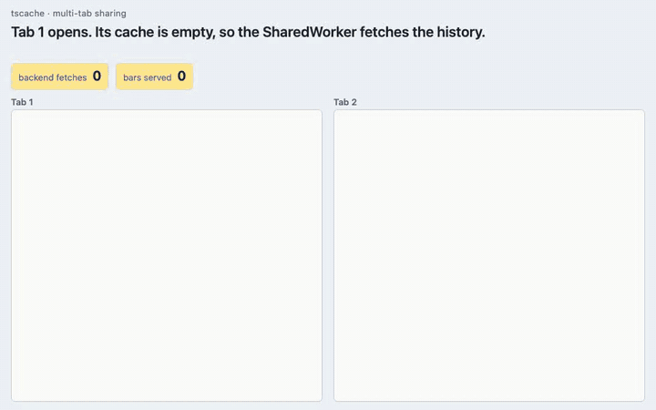
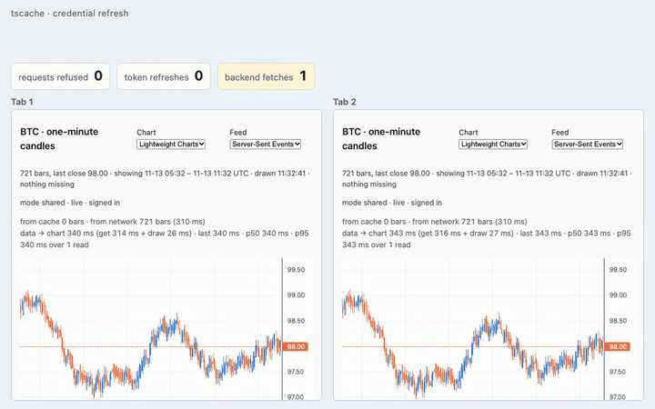
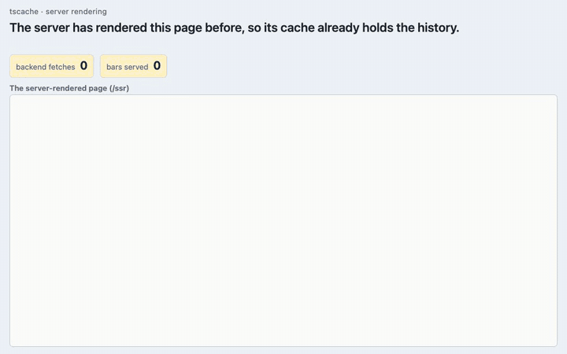
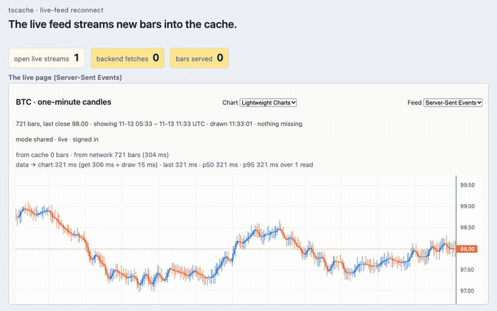

# tscache

[](https://github.com/anishbenji/tscache/actions/workflows/ci.yml)
[](https://www.npmjs.com/package/@anishbenji/tscache)
[](https://www.npmjs.com/package/@anishbenji/tscache#provenance)
[](https://bundlejs.com/?q=@anishbenji/tscache)
[](LICENSE)
[](https://scorecard.dev/viewer/?uri=github.com/anishbenji/tscache)

tscache is a browser cache for timestamp-aligned time series: candles,
metrics, sensor readings, event counts. It runs in a `SharedWorker`, so every
tab of an origin reads one cache, and the worker fetches only the ranges the
cache lacks, joining fetches already in flight from other tabs. Its coverage
tracking tells "not fetched yet" from "confirmed empty" (a weekend, a sensor
dropout), so a known gap is never fetched again. Reads come back as one typed
array per field, ready for a chart. In the
[demo benchmark](docs/benchmarks/demo-comparison.md)'s workload (36 chart
views over one tab, then three), tscache made 8 backend requests where no
cache made 36 and a per-tab cache keyed by exact range made 28.



**Status: 0.x.** Within 0.x a minor release may break the API; a patch release
never does. **Documentation:** <https://anishbenji.github.io/tscache/>.

## Install

```sh
npm install @anishbenji/tscache
```

ESM-only, no runtime dependencies.

## Quick start

With Vite, add the `fetcherUrl()` plugin from `@anishbenji/tscache/vite` and
write a fetcher module whose default export fetches a range from your backend
([Getting started](https://anishbenji.github.io/tscache/guide/getting-started)
shows both, and covers webpack and setups without a bundler). Then create a
client on the page, open a cache and read a range:

```ts
// src/main.ts
import { createClient } from "@anishbenji/tscache";
import workerUrl from "@anishbenji/tscache/worker?worker&url";
import fetcherModule from "./fetcher.ts?fetcher";

const client = await createClient({
  workerUrl,
  fetcher: { module: fetcherModule },
});

const MINUTE = 60_000;
const candles = await client.cache({
  id: "candles/ACME",
  interval: MINUTE, // required: there is no default
  fields: { open: "f64", high: "f64", low: "f64", close: "f64", volume: "f64" },
});

const now = Math.floor(Date.now() / MINUTE) * MINUTE;
const result = await candles.get({ start: now - 6 * 60 * MINUTE, end: now });
// result.timestamps and result.fields: the points, one typed array per field
// result.coverage: the ranges the cache knows for certain
// result.misses: the ranges it does not, each with a reason
console.log(result.timestamps.length, result.misses);
```

A read never rejects because data is unavailable: a failed fetch comes back as
a miss. The [package README](packages/tscache/README.md) has the full quick
start, the entries and browser support.

## Demos

Each recording is the vanilla reference client (`reference/vanilla`) in the
demo hub, recorded headless with Playwright; the counters above the page are
its mock backend's. The recording script lands in a later step. The two tabs are two frames of one page, which share the
origin's SharedWorker as two tabs do.

**Credential refresh.** The backend expires the access token; tab 1 scrolls
back, the backend refuses its fetches, and one tab refreshes the token for
both.



**Server rendering.** The server has rendered the page before, so its
in-process cache already holds the history; it renders the page from it, and
the browser's cache starts from that read and fetches only the newest bars.



**Live-feed reconnect.** The backend drops the live stream and moves its clock
a minute on; the feed reconnects, and one small fetch mends the bar the outage
broke in.



## Links

- [Documentation site](https://anishbenji.github.io/tscache/): getting started,
  the concepts, every public API with an example, how it works, guides,
  framework and chart wiring, and the generated API reference.
- [Demo benchmark](docs/benchmarks/demo-comparison.md): tscache against no
  cache, a per-tab memo and TanStack Query, on one seeded workload, with its
  method and limits.
- [Known limits of 0.1.0](https://anishbenji.github.io/tscache/#known-limits):
  unbounded memory, deploy skew, and no change notifications.
- [Architecture](docs/architecture.md): the API surface, the RPC protocol and
  the decision register. [Roadmap](docs/roadmap.md): what v1 leaves out.
- [Changelog](CHANGELOG.md), [contributing](CONTRIBUTING.md),
  [security](SECURITY.md).

## Working in this repository

The documentation site is VitePress, in [`site/`](site/), and deploys to
GitHub Pages on every push to `main` (`.github/workflows/pages.yml`). Build or
serve it locally:

```sh
bun install
bun run docs:dev     # serves it with live reload at http://localhost:5173/tscache/
bun run docs:build   # builds it into site/.vitepress/dist
```

### Examples

Runnable apps under [`examples/`](examples/), each a narrative page on the
design decision it demonstrates. They share a synthetic backend
([`examples/mock-backend`](examples/mock-backend)) that every example's Vite
server mounts under `/api/`. The reference clients under
[`reference/`](reference/) are the complete live-market page in vanilla
TypeScript, React and Solid, meant to be copied.

| App                                         | Scenario                                                                     |
| ------------------------------------------- | ---------------------------------------------------------------------------- |
| [`vanilla-uplot`](examples/vanilla-uplot)   | Live server metrics with a volatile tail; sparse event counts                |
| [`solid-uplot`](examples/solid-uplot)       | IoT sensor with dropout gaps and an integer field                            |
| [`solid-lwcharts`](examples/solid-lwcharts) | OHLCV scroll-back over nights and weekends                                   |
| [`react-lwcharts`](examples/react-lwcharts) | Two tabs, one SharedWorker; token refresh across tabs                        |
| [`react-ssr`](examples/react-ssr)           | Server-rendered candles; the browser's cache hydrated from the server's read |
| [`solid-ssr`](examples/solid-ssr)           | Server-rendered sensor; confirmed gaps travel with the coverage              |
| [`benchmark`](examples/benchmark)           | tscache against three baselines on one workload                              |

```sh
bun install && bun run build
bun run --cwd examples/vanilla-uplot dev
```

### Demo hub

`bun run demo` builds the package, every example and every reference client,
serves each on its own local port with its own mock backend, and opens a hub
at <http://127.0.0.1:5400/> (`DEMO_PORT` moves it; the apps take the next ten
ports). The hub links every page, client-only and server-rendered, both chart
libraries and all three live feeds, says what each one shows, and has a live
panel of every backend's counters (fetches, refused requests, token refreshes,
open streams) with buttons to expire a token, drop the live streams or restate
history. Open a page twice to watch two tabs share one SharedWorker: the second
tab draws at once and adds at most the newest bars to the fetch count. Ctrl-C
stops everything.

### Framework integrations

Type-checked snippets under [`integrations/`](integrations/) for vanilla
JavaScript, React, Solid, Vue, Svelte and Angular, each client-only and
server-rendered with hydration. They share a small framework-neutral core:
the client's lifecycle (connect once, replace it when its worker is lost,
dispose on teardown) and the hydration of a server's read. A framework adds
only the step from a promise to its own reactivity.

## License

[MIT](LICENSE)
