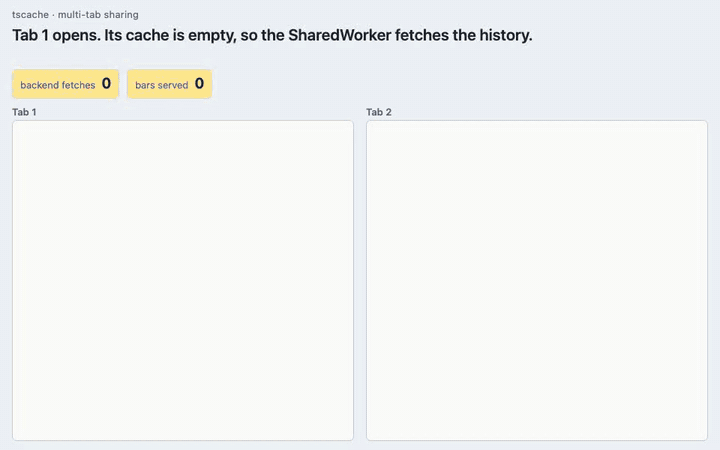

# @anishbenji/tscache

A browser cache for timestamp-aligned time series: candles, metrics, sensor
readings, event counts. It is built for a chart that scrolls through history
and follows a live tail, in several tabs at once.

**Measured benefit:** in the
[demo comparison](https://github.com/anishbenji/tscache/blob/main/docs/benchmarks/demo-comparison.md)'s
workload (36 chart views over one tab, then three), tscache made 8 backend
requests where no cache made 36 and a per-tab cache keyed by exact range made
28.



- **One cache for every tab.** The cache runs in a `SharedWorker`, so every
  same-origin tab reads the same data. Without `SharedWorker` it falls back to
  a dedicated `Worker`, then to the page itself; those give each tab a cache of
  its own, shared with no other tab.
- **The worker fetches.** You give it a fetcher module. The worker fetches
  only what's missing, and tabs share fetches already in flight when they
  share a SharedWorker (see [Browser support](#browser-support)).
  [How a read fetches](https://anishbenji.github.io/tscache/concepts/coverage#how-a-read-fetches)
  has the details.
- **Known gaps are first-class.** Coverage records what the cache _knows_,
  separately from the points that _exist_. A weekend without candles is a
  confirmed gap: it is never fetched again, and it is not confused with "not
  loaded yet".
- **Columns, not objects.** A read returns one typed array per field, which
  chart libraries take as they are, moved from the worker without copying.
- **Honest freshness.** A watermark marks the provisional tail that is always
  fetched again, a dataset version clears the cache when history changes, and
  `invalidate` forgets a range on your own clock. There is no TTL.

ESM-only, no runtime dependencies.

## Install

```sh
npm install @anishbenji/tscache
```

## Quick start

With Vite, add the plugin that serves the fetcher module:

```ts
// vite.config.ts
import { fetcherUrl } from "@anishbenji/tscache/vite";
import { defineConfig } from "vite";

export default defineConfig({
  plugins: [fetcherUrl()],
  worker: { format: "es" },
});
```

Write a fetcher. The worker loads it with `import()` and calls its default
export with the range to fetch:

```ts
// src/fetcher.ts
import type { Fetcher } from "@anishbenji/tscache/fetcher";

const fetcher: Fetcher = {
  async fetch(request) {
    const { start, end } = request.range;
    const response = await fetch(
      `/api/series/${request.cacheId}?start=${start}&end=${end}`,
    );
    if (!response.ok) throw new Error(`backend answered ${response.status}`);
    // { timestamps, fields, meta: { version, finalizedUntil } }
    // finalizedUntil: the first timestamp that is not final yet. Points at or
    // after it are fetched again. It only moves forward: a response without it
    // leaves it where it is, and a cache that never had one treats every point
    // and gap as final.
    return response.json();
  },
};

export default fetcher;
```

For TypeScript, declare the `?fetcher` import once, in a file your
`tsconfig.json` includes, such as `src/` (Vite's client types already declare
`?worker&url`):

```ts
// src/env.d.ts
declare module "*?fetcher" {
  const url: string;
  export default url;
}
```

Then create a client on the page, open a cache and read a range:

```ts
// src/main.ts
import { createClient } from "@anishbenji/tscache";
import workerUrl from "@anishbenji/tscache/worker?worker&url";
import fetcherModule from "./fetcher.ts?fetcher";

const client = await createClient({
  workerUrl,
  fetcher: { module: fetcherModule },
});

const MINUTE = 60_000;
const candles = await client.cache({
  id: "candles/ACME",
  interval: MINUTE, // required: there is no default
  fields: { open: "f64", high: "f64", low: "f64", close: "f64", volume: "f64" },
});

const now = Math.floor(Date.now() / MINUTE) * MINUTE;
const result = await candles.get({ start: now - 6 * 60 * MINUTE, end: now });
// result.timestamps and result.fields: the points, one typed array per field
// result.coverage: the ranges the cache knows for certain
// result.misses: the ranges it does not, each with a reason
console.log(result.timestamps.length, result.misses);
```

A read never rejects because data is unavailable: a failed fetch comes back as
a miss. The [getting-started guide](https://anishbenji.github.io/tscache/guide/getting-started)
covers webpack, setups without a bundler, and the full fetcher contract.

## Entries

| Import                        | For                                                                                    |
| ----------------------------- | -------------------------------------------------------------------------------------- |
| `@anishbenji/tscache`         | the page: `createClient`, the types, the errors, `encodeSnapshot` and `decodeSnapshot` |
| `@anishbenji/tscache/worker`  | the worker script; you serve it, you never import it into the page                     |
| `@anishbenji/tscache/fetcher` | your fetcher module: its types and `AuthInvalidError`, nothing else                    |
| `@anishbenji/tscache/engine`  | the engine without a worker, for Node, server rendering and tests                      |
| `@anishbenji/tscache/vite`    | `fetcherUrl()`, the Vite plugin for the fetcher module (`vite` 8 is an optional peer)  |

## Browser support

`createClient` tries three hostings in this order, starting from its `mode`
option (default `"shared"`), and reports the one it settled on as
`client.mode`:

1. **SharedWorker** (`"shared"`), where the browser has it. Every same-origin
   tab that loads the same worker script shares one cache and its fetches.
2. **Dedicated worker** (`"dedicated"`): one `Worker` per tab, each with a cache
   of its own.
3. **In-process** (`"in-process"`): the engine in the page itself, with no
   sharing.

Each step down emits a `modeFallback` event with the reason. Chrome on Android
before version 148 has no `SharedWorker`, so there every tab gets its own cache
through the dedicated worker. Only the SharedWorker hosting persists a cache with
`persist: true`. [Workers and fallback](https://anishbenji.github.io/tscache/guides/workers)
has the details.

## Stability

tscache follows semantic versioning within 0.x: a minor release (0.2.0) may
break the API, a patch release (0.1.1) never does. Pin a minor range
(`~0.1.0`) to take fixes without breaking changes.
[Known limits](https://anishbenji.github.io/tscache/#known-limits) of 0.1.0:
unbounded memory, deploy skew, and no change notifications.

## Documentation

- [Documentation site](https://anishbenji.github.io/tscache/): concepts,
  every public API with an example, guides and the API reference.
- [Coverage and gaps](https://anishbenji.github.io/tscache/concepts/coverage):
  what a result says.
- [Workers and fallback](https://anishbenji.github.io/tscache/guides/workers):
  serving the worker with any bundler.
- [Changelog](https://github.com/anishbenji/tscache/blob/main/CHANGELOG.md)
- [Source and issues](https://github.com/anishbenji/tscache)

## License

[MIT](./LICENSE)
