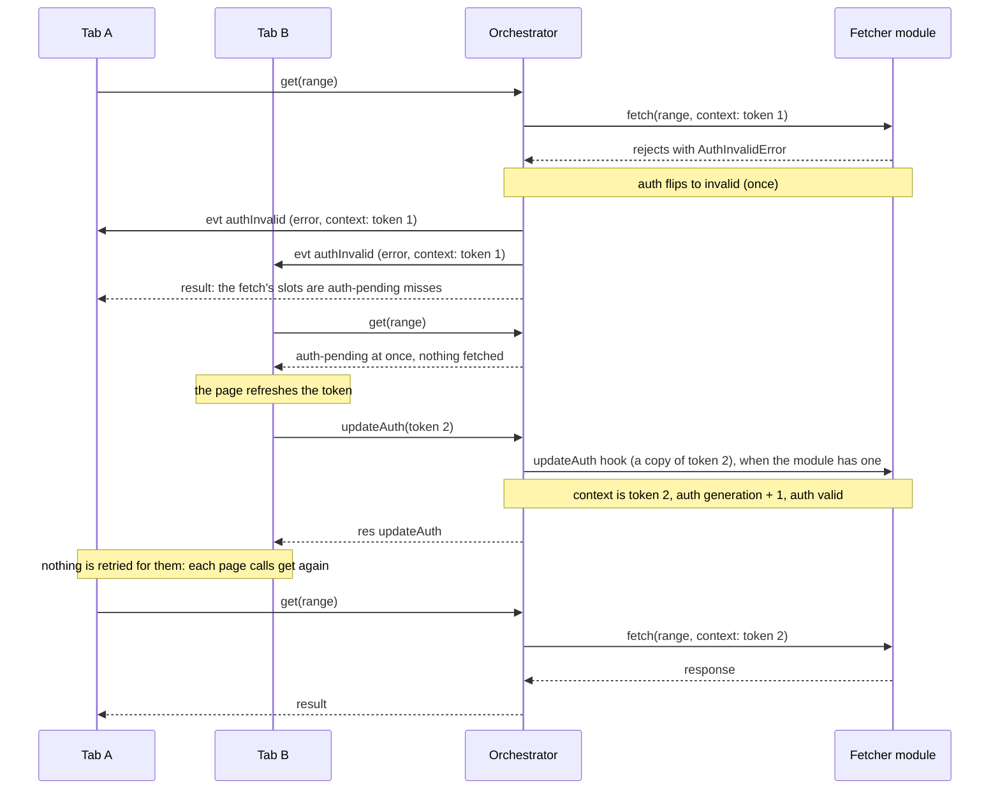

# Auth refresh

The fetcher module carries the credentials; the orchestrator keeps one auth state for everything its
engine fetches. This page follows a refused token from the fetcher to a refresh and the next read. The
[credentials guide](/guides/auth) shows the code a page writes around it. The tabs' requests and the
events pass through the `RpcServer`, which the diagram leaves out.

1. **The refusal.** The fetcher throws an `AuthInvalidError` when the backend refuses its credentials.
   The orchestrator recognises it by its marker, `code === 'tscache:auth-invalid'`, not by class. If the
   fetch started under the current auth generation, auth becomes invalid; a refusal of a fetch started
   before the last `updateAuth` is ignored, since it says nothing about the newer credentials.
2. **The broadcast.** On the flip to invalid, and only then, the server sends `authInvalid` to every
   ready port, with the error and the context the refused fetch carried. In the shared hosting that is
   every connected tab; a dedicated worker or an in-process engine has one client, so only that tab
   hears it.
3. **Reads do not wait.** Reads still waiting on fetches are released at the flip: their outstanding
   fetches are reported as `'auth-pending'` and finish in the background. While auth is invalid, a read
   fetches and joins nothing, and its missing slots come back as `'auth-pending'` at once. A
   `cacheOnly` read never reaches the auth state.
4. **The update.** A page calls `client.updateAuth(context)`. Updates apply one at a time, in call
   order. The orchestrator waits for the fetcher module's load if it is still running, then calls the
   module's optional `updateAuth` hook with a copy of the context. While the hook runs, reads fetch and
   join nothing and report `'auth-pending'`. Then the new context and the next auth generation take
   effect together, and auth is valid again. If the hook throws, `updateAuth` rejects and the previous
   context stays in place. Without a fetcher module, `updateAuth` does nothing.
5. **The next read.** Nothing is retried automatically: a read that already returned `'auth-pending'`
   stays answered. Each page calls `get` again; the new fetches carry the new context.

A tab that joins with `createClient({ fetcher: { module, context } })` while another tab's context is in
place sends its context in `init`. When it is not the identical value, the worker applies it through
the same `updateAuth` path ([Sharing across tabs](./tabs#later-tabs)).

Drawn from:

- [`packages/tscache/src/orchestrator/orchestrator.ts#Orchestrator`](https://github.com/anishbenji/tscache/blob/main/packages/tscache/src/orchestrator/orchestrator.ts)
- [`packages/tscache/src/orchestrator/auth.ts#AuthState`](https://github.com/anishbenji/tscache/blob/main/packages/tscache/src/orchestrator/auth.ts)
- [`packages/tscache/src/errors.ts#AuthInvalidError`](https://github.com/anishbenji/tscache/blob/main/packages/tscache/src/errors.ts)
- [`packages/tscache/src/errors.ts#isAuthInvalidError`](https://github.com/anishbenji/tscache/blob/main/packages/tscache/src/errors.ts)
- [`packages/tscache/src/errors.ts#AUTH_INVALID_CODE`](https://github.com/anishbenji/tscache/blob/main/packages/tscache/src/errors.ts)
- [`packages/tscache/src/rpc/server.ts#RpcServer`](https://github.com/anishbenji/tscache/blob/main/packages/tscache/src/rpc/server.ts)
- [`packages/tscache/src/client/client.ts#TscacheClient`](https://github.com/anishbenji/tscache/blob/main/packages/tscache/src/client/client.ts)
- [`packages/tscache/src/client/events.ts#ClientEmitter`](https://github.com/anishbenji/tscache/blob/main/packages/tscache/src/client/events.ts)
- [`packages/tscache/src/types.ts#Fetcher`](https://github.com/anishbenji/tscache/blob/main/packages/tscache/src/types.ts)
