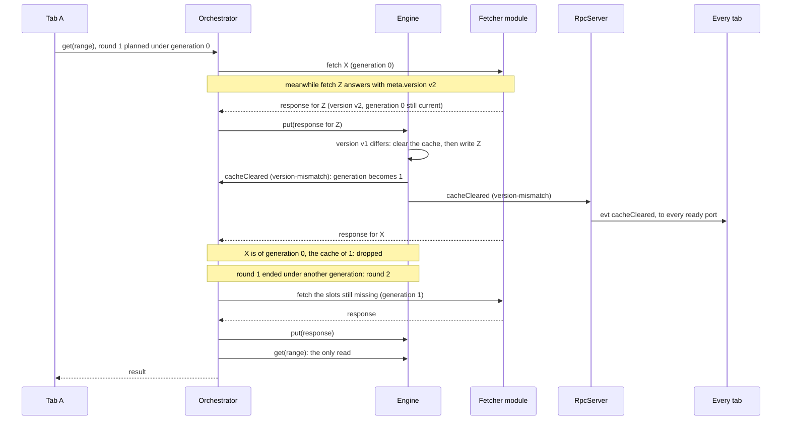
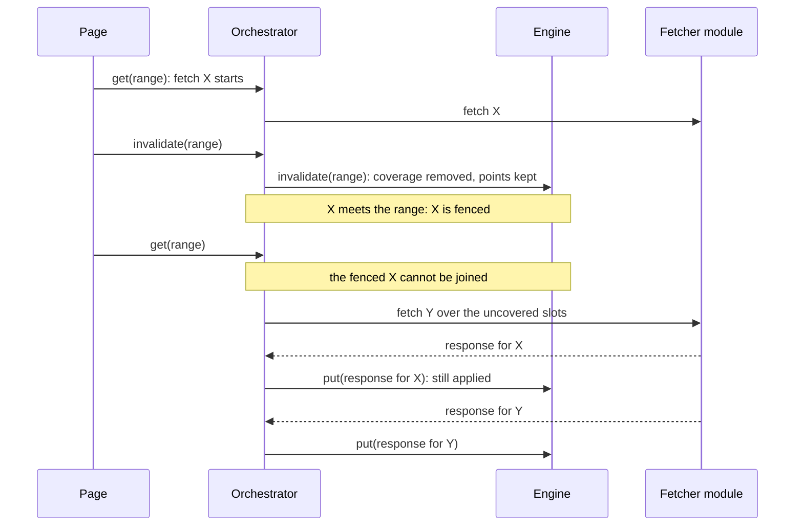

# Fences and invalidation

Fetches take time, and the cache can change while they are out. Two fences keep a late response or a
shared fetch from undoing such a change: the clear generation, for clears, and the invalidate fence, for
`invalidate`. In the diagrams a page's requests reach the orchestrator through the `RpcServer`, which is
drawn only where it does more than pass them on.

## The clear generation

The orchestrator counts, per cache, every `cacheCleared` the engine emits: a manual `clear`, a
`clearAll`, and a put whose `meta.version` differs from the cache's version. That count is the cache's
clear generation. Each fetch records the generation it was started under.

1. **A clear moves the generation.** The engine emits `cacheCleared` with a reason (`'manual'`,
   `'clear-all'` or `'version-mismatch'`). The orchestrator's listener adds one to the cache's
   generation, and the server sends the event to every ready port. A version mismatch is detected inside
   the put that carries the new version: the cache is cleared, then that put is written, and the event
   follows. The first version a cache sees is adopted without a clear.
2. **A stale response is dropped.** When a fetch settles, its generation is compared with the cache's
   current one. If they differ, the response is not applied: it describes data from before the clear.
3. **A read re-plans once.** A read compares the generation its round was planned under with the
   generation when the fetches it awaited have settled. If the cache was cleared meanwhile, whether the
   clear dropped one of its responses or wiped one already applied, it plans a second round. That round
   asks for what is still missing, minus the ranges whose fetch failed or came back auth-pending, and
   joins only fetches of the new generation. What a clear during the second round drops comes back as
   an `'uncached'` miss: there is no third round.
4. **Joins respect the generation.** A fetch of an older generation is never joined, so a read after a
   clear never waits for a fetch that this clear will drop.

## The invalidate fence

`invalidate(range)` forgets coverage over the range, snapped outward to the grid, and keeps the points.
Fetches in flight over that range are fenced so that no later read joins them.

1. **The engine forgets coverage first.** `Orchestrator.invalidate` calls `Engine.invalidate`, which
   subtracts the range, snapped outward, from the coverage index. An invalid range throws there,
   before anything is fenced.
2. **Overlapping fetches are fenced.** Every in-flight fetch for the cache whose range meets the snapped
   range is marked fenced. A fence is never lifted.
3. **Later reads fetch anew.** A read after the invalidate sees the slots as missing and finds none
   of the fenced fetches joinable, so it starts its own or joins one issued after the invalidate.
4. **Fenced responses still land.** A fenced fetch is still applied when it arrives, as any other fetch;
   the fence only keeps new reads from relying on it. A read that had already joined it before the
   invalidate goes on waiting for it.

Drawn from:

- [`packages/tscache/src/orchestrator/orchestrator.ts#Orchestrator`](https://github.com/anishbenji/tscache/blob/main/packages/tscache/src/orchestrator/orchestrator.ts)
- [`packages/tscache/src/orchestrator/orchestrator.ts#blockedBy`](https://github.com/anishbenji/tscache/blob/main/packages/tscache/src/orchestrator/orchestrator.ts)
- [`packages/tscache/src/orchestrator/orchestrator.ts#annotate`](https://github.com/anishbenji/tscache/blob/main/packages/tscache/src/orchestrator/orchestrator.ts)
- [`packages/tscache/src/engine/engine.ts#Engine`](https://github.com/anishbenji/tscache/blob/main/packages/tscache/src/engine/engine.ts)
- [`packages/tscache/src/engine/engine.ts#EngineEvents`](https://github.com/anishbenji/tscache/blob/main/packages/tscache/src/engine/engine.ts)
- [`packages/tscache/src/engine/cache.ts#CacheState`](https://github.com/anishbenji/tscache/blob/main/packages/tscache/src/engine/cache.ts)
- [`packages/tscache/src/rpc/server.ts#RpcServer`](https://github.com/anishbenji/tscache/blob/main/packages/tscache/src/rpc/server.ts)
- [`packages/tscache/src/coverage.ts#CoverageIndex`](https://github.com/anishbenji/tscache/blob/main/packages/tscache/src/coverage.ts)
