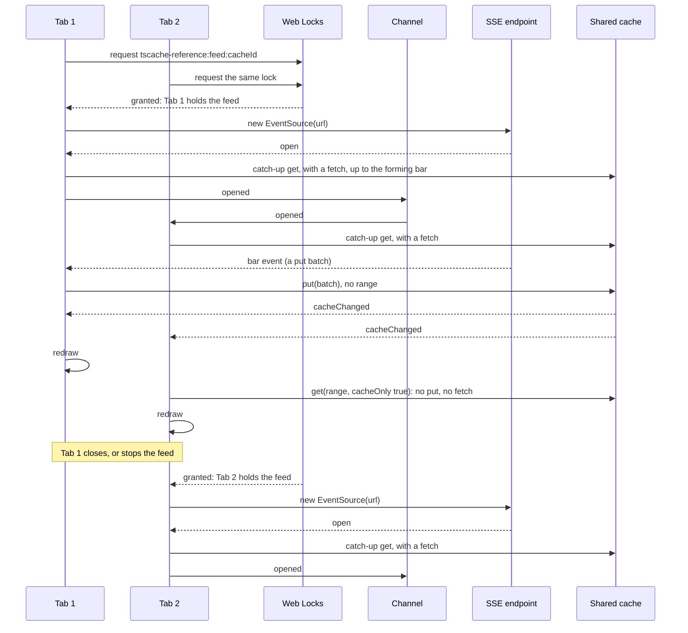

# Live feeds

New bars reach a cache through `put` or a fetching `get`, and `cacheChanged` tells every listening tab
where the cache changed. The reference clients add a live feed on top of it, in
[`reference/shared/src/live.ts`](https://github.com/anishbenji/tscache/blob/main/reference/shared/src/live.ts).
This flow is that application code, not part of the package. One tab per browser holds the feed,
elected with a Web Lock, and the bars it brings go into the shared cache. The
[live feeds guide](/guides/live-feeds) covers the cache side of pushing and polling.

1. **The election.** Every tab's `liveFeed` opens a `BroadcastChannel` and requests a Web Lock, both
   named `tscache-reference:feed:<cache id>`. The tab granted the lock runs the source (Server-Sent
   Events, a WebSocket or polling) for as long as it holds it. The others wait in the lock's queue.
2. **The opening.** Each time the holder's source opens (the first connection, a reconnect, or a new
   holder), the holder calls `onOpened` and then tells the other tabs. Bars may have been missed while
   no source was open, so each tab that follows the market reads up to the forming bar with a fetching
   `get`, which mends both missed bars and a forming bar's final values.
3. **A pushed bar.** The holder puts each pushed batch into the cache without a range: it adds and
   overwrites the bars it carries and claims coverage only for its own span below the watermark. It
   also passes the batch on the channel, for tabs with a cache of their own.
4. **Every tab.** In the shared hosting the holder's put went into the one cache every tab reads, and
   its `cacheChanged` event reaches every tab, the holder's own included. When the written bars meet the
   screen the tab redraws, and the redraw reads the range with `cacheOnly: true`, so the bar costs no
   fetch; bars after a gap the feed did not fill start a fetching catch-up instead. A tab with a cache of
   its own, a dedicated worker or in-process, hears no other tab's change: it puts the batch from the
   channel into its own cache, then redraws.
5. **Polling.** A polling holder reads the time since its last complete poll with a fetching `get`
   instead; in the shared hosting the fetch's `cacheChanged` tells every tab, and the others read it back
   from the cache. It passes the span on the channel for tabs with a cache of their own.
6. **Handover.** When the holder's tab closes or stops its feed, the browser releases the lock and
   grants it to the next waiting tab, which starts its own source; its opening runs step 2 again.

Drawn from:

- [`reference/shared/src/live.ts#liveFeed`](https://github.com/anishbenji/tscache/blob/main/reference/shared/src/live.ts)
- [`reference/shared/src/live.ts#eventSource`](https://github.com/anishbenji/tscache/blob/main/reference/shared/src/live.ts)
- [`reference/shared/src/live.ts#webSocket`](https://github.com/anishbenji/tscache/blob/main/reference/shared/src/live.ts)
- [`reference/shared/src/live.ts#polling`](https://github.com/anishbenji/tscache/blob/main/reference/shared/src/live.ts)
- [`reference/shared/src/session.ts#startSession`](https://github.com/anishbenji/tscache/blob/main/reference/shared/src/session.ts)
- [`integrations/vanilla/series.ts#series`](https://github.com/anishbenji/tscache/blob/main/integrations/vanilla/series.ts)
- [`packages/tscache/src/client/cache.ts#CacheHandle`](https://github.com/anishbenji/tscache/blob/main/packages/tscache/src/client/cache.ts)
- [`packages/tscache/src/engine/cache.ts#CacheState`](https://github.com/anishbenji/tscache/blob/main/packages/tscache/src/engine/cache.ts)
