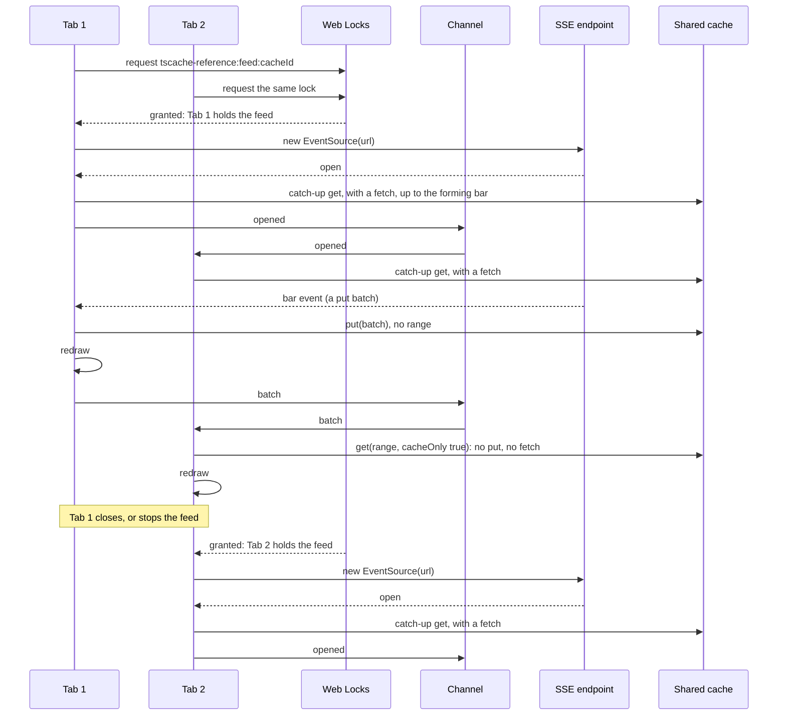

# Live feeds

tscache has no subscriptions: new bars reach a cache through `put` or a fetching `get`. The reference
clients add a live feed on top of it, in
[`reference/shared/src/live.ts`](https://github.com/anishbenji/tscache/blob/main/reference/shared/src/live.ts).
This flow is that application code, not part of the package. One tab per browser holds the feed,
elected with a Web Lock, and the bars it brings go into the shared cache. The
[live feeds guide](/guides/live-feeds) covers the cache side of pushing and polling.

1. **The election.** Every tab's `liveFeed` opens a `BroadcastChannel` and requests a Web Lock, both
   named `tscache-reference:feed:<cache id>`. The tab granted the lock runs the source (Server-Sent
   Events, a WebSocket or polling) for as long as it holds it. The others wait in the lock's queue.
2. **The opening.** Each time the holder's source opens (the first connection, a reconnect, or a new
   holder), the holder calls `onOpened` and then tells the other tabs. Bars may have been missed while
   no source was open, so each tab that follows the market reads up to the forming bar with a fetching
   `get`, which mends both missed bars and a forming bar's final values.
3. **A pushed bar.** The holder puts each pushed batch into the cache without a range: it adds and
   overwrites the bars it carries and claims coverage only for its own span below the watermark. It
   then redraws and passes the batch on the channel.
4. **The other tabs.** In the shared hosting a tab that hears a batch does not put it, since the
   holder's put went into the one cache every tab reads. When the bars meet the screen it redraws, and
   the redraw reads the range with `cacheOnly: true`, so the bar costs no fetch; bars after a gap the
   feed did not fill start a fetching catch-up instead. A tab with a cache of its own, a dedicated worker or
   in-process, puts the batch into its own cache first.
5. **Polling.** A polling holder reads the time since its last complete poll with a fetching `get`
   instead, and passes the span; in the shared hosting the other tabs read it back from the cache.
6. **Handover.** When the holder's tab closes or stops its feed, the browser releases the lock and
   grants it to the next waiting tab, which starts its own source; its opening runs step 2 again.

Drawn from:

- [`reference/shared/src/live.ts#liveFeed`](https://github.com/anishbenji/tscache/blob/main/reference/shared/src/live.ts)
- [`reference/shared/src/live.ts#eventSource`](https://github.com/anishbenji/tscache/blob/main/reference/shared/src/live.ts)
- [`reference/shared/src/live.ts#webSocket`](https://github.com/anishbenji/tscache/blob/main/reference/shared/src/live.ts)
- [`reference/shared/src/live.ts#polling`](https://github.com/anishbenji/tscache/blob/main/reference/shared/src/live.ts)
- [`reference/shared/src/session.ts#startSession`](https://github.com/anishbenji/tscache/blob/main/reference/shared/src/session.ts)
- [`integrations/vanilla/series.ts#series`](https://github.com/anishbenji/tscache/blob/main/integrations/vanilla/series.ts)
- [`packages/tscache/src/client/cache.ts#CacheHandle`](https://github.com/anishbenji/tscache/blob/main/packages/tscache/src/client/cache.ts)
- [`packages/tscache/src/engine/cache.ts#CacheState`](https://github.com/anishbenji/tscache/blob/main/packages/tscache/src/engine/cache.ts)
