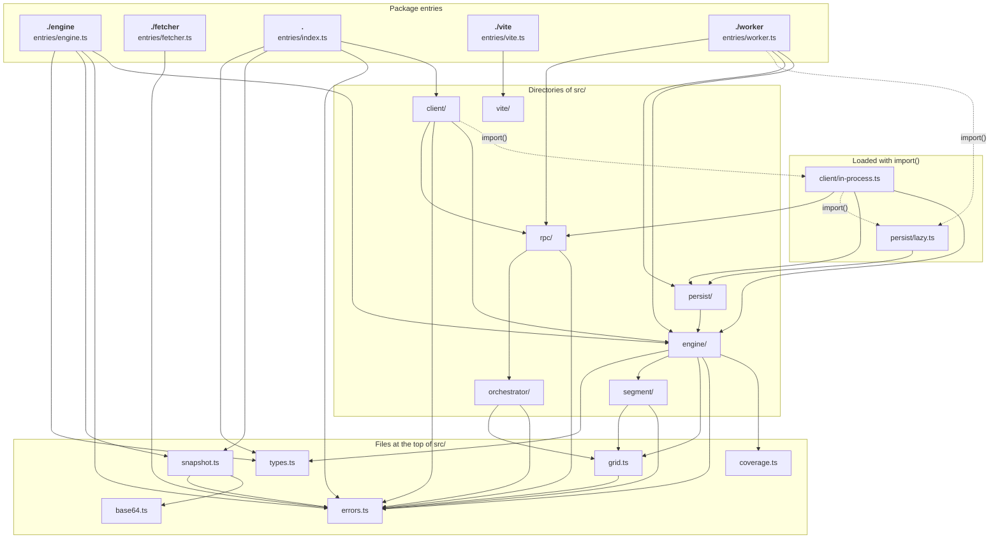

# Package map

`@anishbenji/tscache` has five entries. Each is a separate import path with its own module graph, so an
application loads only what the entry it imports reaches.

| Entry       | Platform | What it is                                                                                                                                                                         |
| ----------- | -------- | ---------------------------------------------------------------------------------------------------------------------------------------------------------------------------------- |
| `.`         | browser  | the client API: `createClient`, the `CacheHandle` and client types, the errors, `encodeSnapshot` and `decodeSnapshot`, `DTYPES`                                                    |
| `./worker`  | browser  | the worker script. Loading it attaches a server to the worker's global scope, as a SharedWorker or a dedicated worker; it is the one file the package marks as having side effects |
| `./engine`  | browser  | the `Engine` with no worker and no port, for server code, Node and tests; it imports no client, RPC or worker code                                                                 |
| `./fetcher` | browser  | what a fetcher module needs: `AuthInvalidError`, `AUTH_INVALID_CODE` and the fetcher types; it imports `errors.ts` and nothing else                                                |
| `./vite`    | node     | `fetcherUrl()`, the Vite plugin that serves a fetcher module; a build of its own, sharing no chunk with the browser entries, and importing nothing from Vite at run time           |

The four browser entries are one tsdown build, so the bundler may share chunks between them; `./vite`
is a second build for Node
([`packages/tscache/tsdown.config.ts`](https://github.com/anishbenji/tscache/blob/main/packages/tscache/tsdown.config.ts)).

## Module graph

The graph and the table below are generated from the package's source by
[`site/scripts/module-graph.ts`](https://github.com/anishbenji/tscache/blob/main/site/scripts/module-graph.ts),
which starts at the files `package.json` exports and follows every relative import. `bun run docs:check`
fails when they no longer match the source; run `bun site/scripts/module-graph.ts` to regenerate them.

How to read it:

- A node is a directory of `packages/tscache/src/`, or a file at its top. Entries, and the files that
  are loaded with `import()`, are nodes of their own.
- A solid arrow from A to B means some file in A imports a file in B. Type-only imports are left out:
  the compiler erases them, so they add nothing to a bundle.
- A dashed arrow is an `import()`: a chunk that loads the first time the code that imports it runs. The
  fetcher module, which the orchestrator loads with `import()` from a URL it receives at run time, is
  not part of the package and does not appear.

<!-- module-graph:start (generated by site/scripts/module-graph.ts; do not edit) -->

| Entry       | Source               | Bundles (static imports)                                                                                                                                                                                                                                                                       | Loads on demand (`import()`)                                                                                                                                                                                                                                                                                                                                                                                                                                            |
| ----------- | -------------------- | ---------------------------------------------------------------------------------------------------------------------------------------------------------------------------------------------------------------------------------------------------------------------------------------------- | ----------------------------------------------------------------------------------------------------------------------------------------------------------------------------------------------------------------------------------------------------------------------------------------------------------------------------------------------------------------------------------------------------------------------------------------------------------------------- |
| `.`         | `entries/index.ts`   | `base64`, `errors`, `snapshot`, `types`, `client/` (cache, client, dev, events, hosting), `engine/` (emitter), `rpc/` (lifetime, port-client, protocol)                                                                                                                                        | `client/in-process.ts`, loaded by `client/hosting.ts`, adds `coverage`, `grid`, `client/` (in-process), `engine/` (batch, cache, engine, merge, overlap, read, snapshot, validate), `orchestrator/` (auth, orchestrator), `persist/` (clear-only), `rpc/` (server), `segment/` (assert, dense, dtype, own, payload, types); `persist/lazy.ts`, loaded by `client/in-process.ts`, adds `engine/` (restore), `persist/` (clear-disk, idb-store, lazy, persister, records) |
| `./worker`  | `entries/worker.ts`  | `coverage`, `errors`, `grid`, `types`, `engine/` (batch, cache, emitter, engine, merge, overlap, read, snapshot, validate), `orchestrator/` (auth, orchestrator), `persist/` (clear-only, hosted), `rpc/` (lifetime, protocol, server), `segment/` (assert, dense, dtype, own, payload, types) | `persist/lazy.ts`, loaded by `entries/worker.ts`, adds `engine/` (restore), `persist/` (clear-disk, idb-store, lazy, persister, records)                                                                                                                                                                                                                                                                                                                                |
| `./engine`  | `entries/engine.ts`  | `base64`, `coverage`, `errors`, `grid`, `snapshot`, `types`, `engine/` (batch, cache, emitter, engine, merge, overlap, read, snapshot, validate), `segment/` (assert, dense, dtype, own, payload, types)                                                                                       | nothing                                                                                                                                                                                                                                                                                                                                                                                                                                                                 |
| `./fetcher` | `entries/fetcher.ts` | `errors`                                                                                                                                                                                                                                                                                       | nothing                                                                                                                                                                                                                                                                                                                                                                                                                                                                 |
| `./vite`    | `entries/vite.ts`    | `vite/` (fetcher-url, urls)                                                                                                                                                                                                                                                                    | nothing                                                                                                                                                                                                                                                                                                                                                                                                                                                                 |

<!-- module-graph:end -->

The table lists, for each entry, the files its static imports reach, which is what its bundle carries,
and the chunks it can load later, each with the files that chunk adds to what is already loaded.

## What the graph shows

- **The client entry does not carry the engine.** `.` reaches one engine file, `engine/emitter.ts`,
  through `client/events.ts`. The engine, the orchestrator and the RPC server arrive only when the
  hosting chain reaches the in-process hosting and `client/hosting.ts` imports `client/in-process.ts`.
- **The engine core depends on nothing above it.** `engine/`, `segment/`, `grid.ts` and `coverage.ts`
  import nothing from `client/`, `rpc/`, `orchestrator/` or `persist/`; that is why `./engine` runs in
  Node.
- **Persistence sits beside the engine, not inside it.** `persist/` imports `engine/`, and nothing in
  `engine/` imports `persist/`. The persister, the IndexedDB adapter and `engine/restore.ts` travel in
  the `persist/lazy.ts` chunk. The SharedWorker loads it at its first persisted cache or its first
  `clearAll`; the dedicated-worker and in-process hostings load it only at their first `clearAll`.
- **A fetcher bundle stays small.** `./fetcher` reaches only `errors.ts`.

Drawn from:

- [`packages/tscache/package.json`](https://github.com/anishbenji/tscache/blob/main/packages/tscache/package.json) (`exports`, `sideEffects`)
- [`packages/tscache/src/entries/index.ts#createClient`](https://github.com/anishbenji/tscache/blob/main/packages/tscache/src/entries/index.ts)
- [`packages/tscache/src/entries/worker.ts#createServer`](https://github.com/anishbenji/tscache/blob/main/packages/tscache/src/entries/worker.ts)
- [`packages/tscache/src/entries/engine.ts#Engine`](https://github.com/anishbenji/tscache/blob/main/packages/tscache/src/entries/engine.ts)
- [`packages/tscache/src/entries/fetcher.ts#AuthInvalidError`](https://github.com/anishbenji/tscache/blob/main/packages/tscache/src/entries/fetcher.ts)
- [`packages/tscache/src/entries/vite.ts#fetcherUrl`](https://github.com/anishbenji/tscache/blob/main/packages/tscache/src/entries/vite.ts)
- [`packages/tscache/src/client/hosting.ts#openInProcess`](https://github.com/anishbenji/tscache/blob/main/packages/tscache/src/client/hosting.ts)
- [`packages/tscache/src/client/events.ts#ClientEmitter`](https://github.com/anishbenji/tscache/blob/main/packages/tscache/src/client/events.ts)
- [`packages/tscache/src/persist/lazy.ts#Persister`](https://github.com/anishbenji/tscache/blob/main/packages/tscache/src/persist/lazy.ts)
- [`packages/tscache/src/engine/cache.ts#installRestore`](https://github.com/anishbenji/tscache/blob/main/packages/tscache/src/engine/cache.ts)
