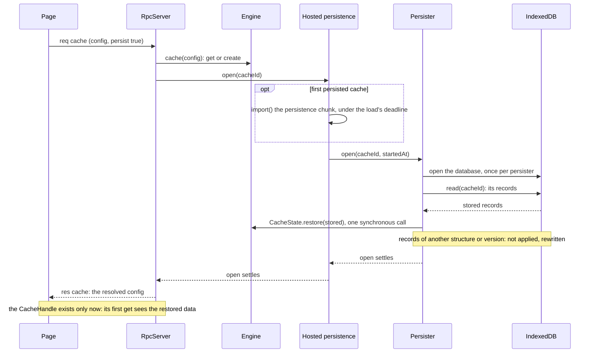
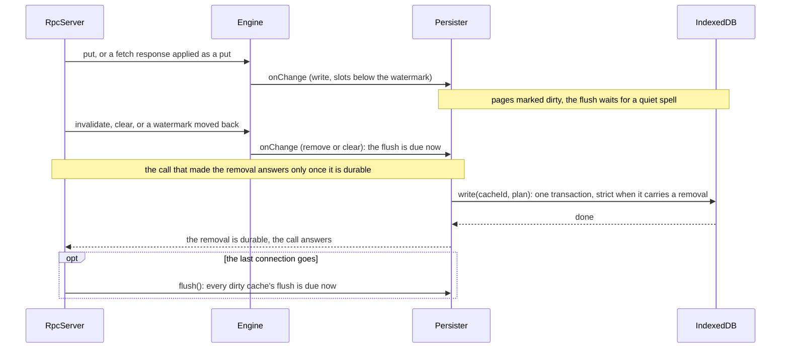
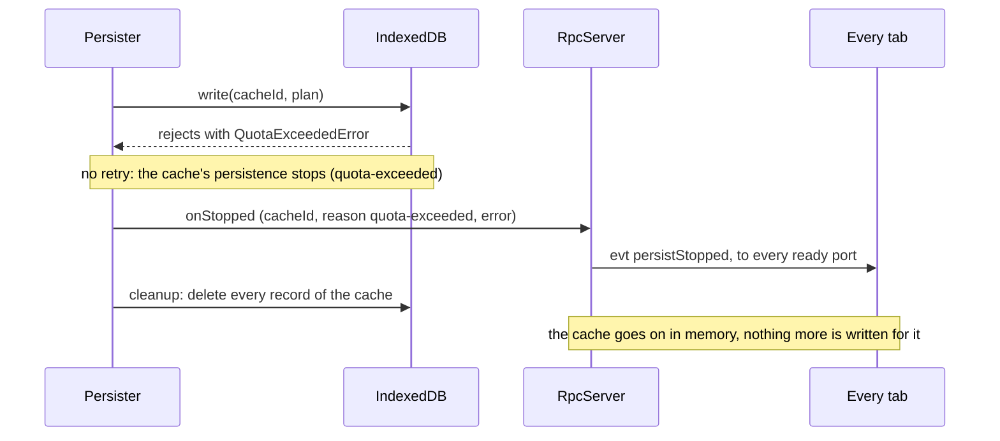

# Persistence

Only the SharedWorker hosting persists. Its server holds a `HostedPersistence`, which loads the
persister and the IndexedDB adapter as a chunk of their own, with `import()`, the first time a cache with
`persist: true` is opened or `clearAll` runs. The dedicated-worker and in-process hostings persist
nothing; where IndexedDB exists, their `clearAll` only empties the database. This page follows a
persisted cache through its restore, its write-back and a quota stop. The
[persistence guide](/guides/persistence) covers the options and the guarantees.

## Restore

1. **`cache()` waits for the load.** The server creates the cache, then, for a persisted cache, answers
   only once the persistence's `open` has settled. No call through a handle can therefore reach a cache
   whose load is pending.
2. **The chunk loads on demand.** Until the chunk has loaded, the server's calls on that cache wait in
   arrival order. A chunk that fails to load, or has not loaded within the deadline (`timeoutMs`,
   default 5000 ms), turns persistence off for the worker's life: every waiting and later open stops
   with `'unavailable'`.
3. **The load has one deadline.** The persister's load must finish within the same `timeoutMs`,
   counted from the `open` call, the chunk's import included; a load still out then stops the cache
   with `'unavailable'`, and `cache()` answers. A store that cannot be opened stops every
   tracked cache with `'unavailable'`; a read that fails stops the cache with `'error'`.
4. **Restore applies into an empty cache.** `CacheState.restore` checks the cache record against the
   cache's structure and version. A record that matches adopts its version, moves the watermark
   forwards only, and writes each valid page's coverage, minus the provisional region, with the page's
   points. A record of another structure or version, or pages without a record, are not applied, and
   the cache is rewritten from memory at the next flush.
5. **A change wins over the load.** If anything mutates the cache while its load is still out, the
   load is abandoned: nothing stored is applied, and the next flush rewrites the cache from memory.

## Write-back

1. **The engine reports, the persister decides.** Every mutating call on a cache reports what it
   changed through the cache's hooks: a write over some slots, clipped below the provisional region, a
   watermark change, a removal, a clear, or a version change. The engine sets no timers; the persister
   does.
2. **Additions wait for a quiet spell.** After a write, the cache's flush is due `debounceMs` (default
   1000 ms) after the last change, but no later than `maxDelayMs` (default 5000 ms) after the first.
3. **Removals are due at once.** A `remove` or `clear` change makes the flush due immediately. The
   server runs every op that names a cache through the persistence: when the op recorded a removal, its
   answer, success or failure, waits until that removal is durable or the cache's persistence has
   stopped.
4. **One writer.** The persister runs one job at a time, removal-carrying jobs first. A flush builds its
   plan from memory alone, without reading the disk: the dirty pages' records (or every record after a
   clear or a version change) and the cache record. The store writes the plan in one transaction, with
   strict durability when it carries a removal.
5. **The last tab.** When the server's last connection goes, it asks the persistence to flush, which
   makes every dirty cache's flush due now.

## Quota stop

1. **A full disk stops the cache.** A write rejected with a `QuotaExceededError` stops that cache's
   persistence at once, without a retry. Its dirty state and queued jobs are dropped.
2. **Every tab hears it.** The persister calls its `onStopped`, which the SharedWorker's server turns
   into a `persistStopped` event for every ready port, with the cache id, the reason and the error. On
   the page, `client.on('persistStopped')` and the handle's `on` (filtered to its cache) receive it.
3. **The records go.** A cleanup job deletes the cache's records. Its own failure is ignored.
4. **Other failures retry first.** Any other rejected write puts its dirty state back and is retried
   after `debounceMs`, under the deadline it had (`timeoutMs` from when the flush was due). When the
   deadline passes, the cache stops with `'error'`, or `'unavailable'` when no attempt had failed yet.

Drawn from:

- [`packages/tscache/src/rpc/server.ts#RpcServer`](https://github.com/anishbenji/tscache/blob/main/packages/tscache/src/rpc/server.ts)
- [`packages/tscache/src/rpc/server.ts#Persistence`](https://github.com/anishbenji/tscache/blob/main/packages/tscache/src/rpc/server.ts)
- [`packages/tscache/src/entries/worker.ts#createServer`](https://github.com/anishbenji/tscache/blob/main/packages/tscache/src/entries/worker.ts)
- [`packages/tscache/src/persist/hosted.ts#HostedPersistence`](https://github.com/anishbenji/tscache/blob/main/packages/tscache/src/persist/hosted.ts)
- [`packages/tscache/src/persist/clear-only.ts#ClearOnlyPersistence`](https://github.com/anishbenji/tscache/blob/main/packages/tscache/src/persist/clear-only.ts)
- [`packages/tscache/src/persist/clear-only.ts#lazyIdbStore`](https://github.com/anishbenji/tscache/blob/main/packages/tscache/src/persist/clear-only.ts)
- [`packages/tscache/src/persist/persister.ts#Persister`](https://github.com/anishbenji/tscache/blob/main/packages/tscache/src/persist/persister.ts)
- [`packages/tscache/src/persist/persister.ts#PersisterOptions`](https://github.com/anishbenji/tscache/blob/main/packages/tscache/src/persist/persister.ts)
- [`packages/tscache/src/persist/persister.ts#durably`](https://github.com/anishbenji/tscache/blob/main/packages/tscache/src/persist/persister.ts)
- [`packages/tscache/src/persist/store.ts#PersistStore`](https://github.com/anishbenji/tscache/blob/main/packages/tscache/src/persist/store.ts)
- [`packages/tscache/src/persist/store.ts#WritePlan`](https://github.com/anishbenji/tscache/blob/main/packages/tscache/src/persist/store.ts)
- [`packages/tscache/src/persist/idb-store.ts#openIdbStore`](https://github.com/anishbenji/tscache/blob/main/packages/tscache/src/persist/idb-store.ts)
- [`packages/tscache/src/engine/engine.ts#observeCaches`](https://github.com/anishbenji/tscache/blob/main/packages/tscache/src/engine/engine.ts)
- [`packages/tscache/src/engine/cache.ts#CacheState`](https://github.com/anishbenji/tscache/blob/main/packages/tscache/src/engine/cache.ts)
- [`packages/tscache/src/engine/cache.ts#CacheChange`](https://github.com/anishbenji/tscache/blob/main/packages/tscache/src/engine/cache.ts)
- [`packages/tscache/src/engine/restore.ts#restore`](https://github.com/anishbenji/tscache/blob/main/packages/tscache/src/engine/restore.ts)
- [`packages/tscache/src/client/cache.ts#CacheHandle`](https://github.com/anishbenji/tscache/blob/main/packages/tscache/src/client/cache.ts)
