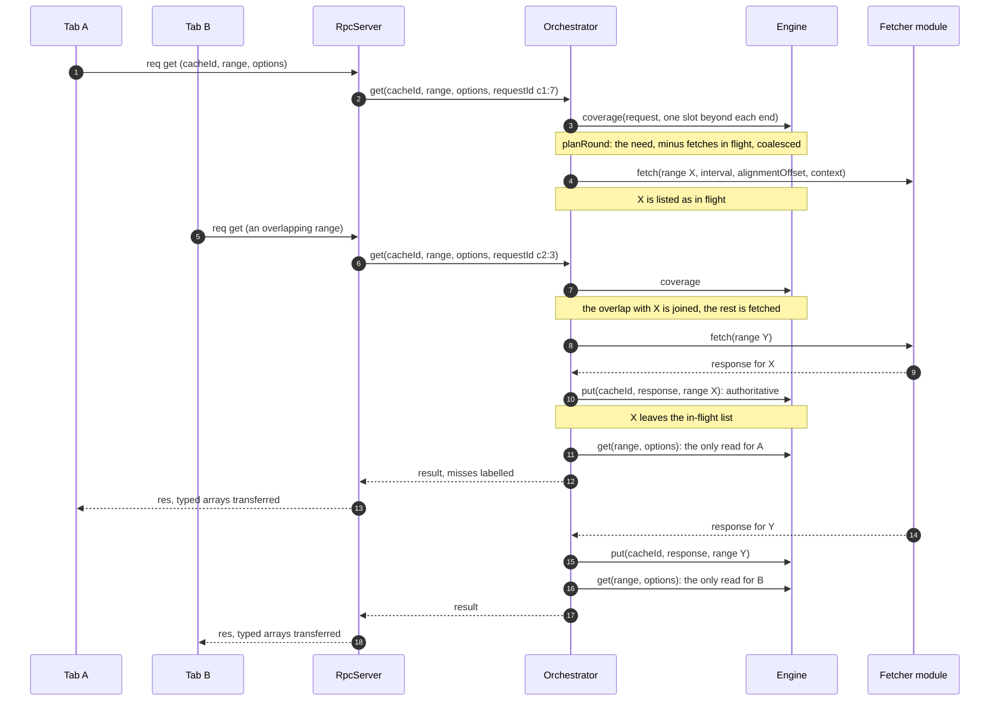

# A read, end to end

`cache.get(range)` is one request from a tab to the engine's hosting. In the hosting the orchestrator
works out what the cache lacks, fetches it, applies the responses and then reads the engine once. This
page follows one read, and a second tab's overlapping read that shares its fetch.

1. **The request.** `CacheHandle.get` sends a `get` request through the tab's `PortClient`, with the
   cache id, the range and the options. The `RpcServer` passes it to `Orchestrator.get` with a request
   id of the form `clientId:seq`, which names the read on the `mergeWarning` events of the fetches it
   starts.
2. **No fetching.** Without a fetcher module, or with `cacheOnly: true`, the orchestrator answers with
   one `Engine.get` and stops here.
3. **The misses.** Otherwise it snaps the range outward to the grid and reads the coverage over it and
   one slot beyond each end, without reading any points. The read's need is its slots outside that
   coverage.
4. **In-flight subtraction.** The need is compared with the fetches in flight for the cache, from any
   tab. Each in-flight fetch that meets the need is joined: the read waits for it instead of asking
   again. Only the need outside every joinable fetch is fetched. A fetch can be joined only if it was
   started under the cache's current clear generation and the current auth generation, and no
   `invalidate` has fenced it ([Fences and invalidation](./fences)). While auth is invalid, or while
   the fetcher's `updateAuth` hook runs, nothing is fetched or joined: the need comes back as
   `'auth-pending'` at once ([Auth refresh](./auth)).
5. **Coalescing.** What is left is merged where it is adjacent, and each piece that touches covered
   slots is extended one slot into them. That one-point overlap lets the response merge with the stored
   segment next to it. Each piece becomes one call to the fetcher's `fetch`, which receives the range in
   milliseconds, the grid's `interval` and `alignmentOffset`, and a copy of the current auth context.
   The read plans and lists its fetches in one synchronous step, so two reads never plan over each
   other.
6. **Apply.** When a response arrives, the orchestrator checks that the cache was not cleared since the
   fetch started (otherwise the response is dropped), then applies it as a put over the range it asked
   for. That makes the range authoritative below the cache's watermark and below the response's own
   `meta.finalizedUntil` ([the watermark](./data-model#the-watermark)). Its merge warnings go to every
   tab as `mergeWarning` events under the request id of the read that started the fetch. The fetch then
   leaves the in-flight list, in the same step.
7. **The wait.** The read waits for its own fetches and the ones it joined, until they all settle or
   auth goes invalid, whichever comes first ([Auth refresh](./auth)).
8. **One more round, at most.** If the cache was cleared while the read waited, it plans once more:
   what is still missing, minus the ranges whose fetch failed or came back auth-pending. There is no
   third round.
9. **The read.** The orchestrator reads the engine once, right after the read's last round, with no
   await in between. Each remaining miss is cut at the edges of the fetches the read
   waited for, and each piece is labelled with its fetch's outcome: `'fetch-failed'` (with the error),
   `'auth-pending'`, or `'uncached'`.
10. **The response.** The server answers with the result, transferring its typed arrays instead of
    copying them, unless the tab's port went away meanwhile.

In the diagram Tab B's read joins `X` and fetches only `Y`. It answers after both have landed, so its
single read sees both responses.

Drawn from:

- [`packages/tscache/src/client/cache.ts#CacheHandle`](https://github.com/anishbenji/tscache/blob/main/packages/tscache/src/client/cache.ts)
- [`packages/tscache/src/rpc/port-client.ts#PortClient`](https://github.com/anishbenji/tscache/blob/main/packages/tscache/src/rpc/port-client.ts)
- [`packages/tscache/src/rpc/server.ts#RpcServer`](https://github.com/anishbenji/tscache/blob/main/packages/tscache/src/rpc/server.ts)
- [`packages/tscache/src/rpc/protocol.ts#transferablesOf`](https://github.com/anishbenji/tscache/blob/main/packages/tscache/src/rpc/protocol.ts)
- [`packages/tscache/src/orchestrator/orchestrator.ts#Orchestrator`](https://github.com/anishbenji/tscache/blob/main/packages/tscache/src/orchestrator/orchestrator.ts)
- [`packages/tscache/src/orchestrator/orchestrator.ts#planRound`](https://github.com/anishbenji/tscache/blob/main/packages/tscache/src/orchestrator/orchestrator.ts)
- [`packages/tscache/src/orchestrator/orchestrator.ts#coalesce`](https://github.com/anishbenji/tscache/blob/main/packages/tscache/src/orchestrator/orchestrator.ts)
- [`packages/tscache/src/orchestrator/orchestrator.ts#blockedBy`](https://github.com/anishbenji/tscache/blob/main/packages/tscache/src/orchestrator/orchestrator.ts)
- [`packages/tscache/src/orchestrator/orchestrator.ts#annotate`](https://github.com/anishbenji/tscache/blob/main/packages/tscache/src/orchestrator/orchestrator.ts)
- [`packages/tscache/src/engine/engine.ts#Engine`](https://github.com/anishbenji/tscache/blob/main/packages/tscache/src/engine/engine.ts)
- [`packages/tscache/src/engine/cache.ts#CacheState`](https://github.com/anishbenji/tscache/blob/main/packages/tscache/src/engine/cache.ts)
- [`packages/tscache/src/grid.ts#snapOut`](https://github.com/anishbenji/tscache/blob/main/packages/tscache/src/grid.ts)
- [`packages/tscache/src/types.ts#Fetcher`](https://github.com/anishbenji/tscache/blob/main/packages/tscache/src/types.ts)
