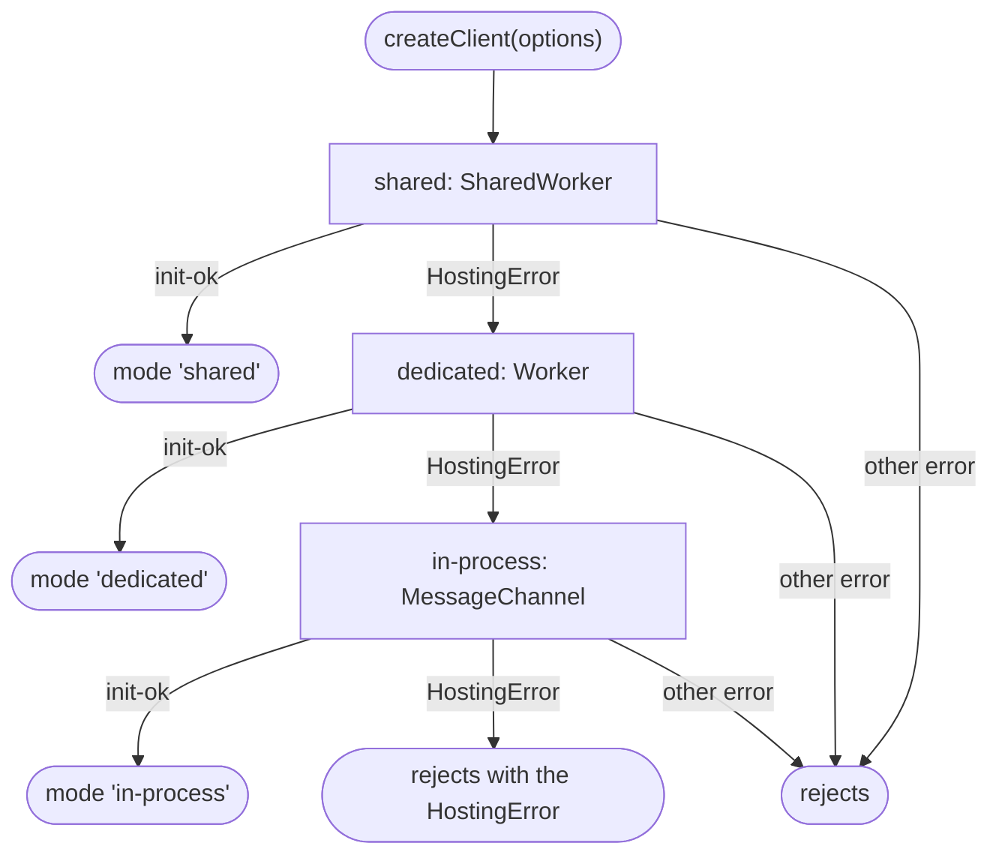
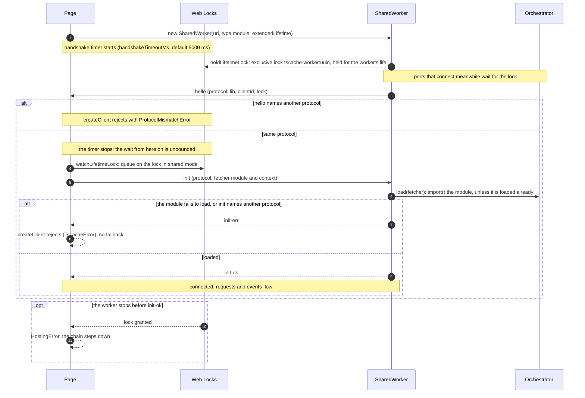

# Startup and fallback

`createClient` connects a page to an engine. It tries three hostings in a fixed order and keeps the first
one whose handshake completes. This page follows that chain, then the handshake every hosting runs.

## The chain

`createClient` first checks its options: the chain is `shared`, `dedicated`, `in-process`, cut to start
at `options.mode`, and `workerUrl` is required unless the chain starts at `in-process`. It then opens
each hosting in turn.

- **A `HostingError` steps down.** A hosting throws one when it cannot start: the constructor is
  missing (`SharedWorker is not available`) or throws, the worker fires an `error` event before
  `init-ok`, no `hello` arrives within `handshakeTimeoutMs`, or, in shared mode, the worker's lifetime
  lock is granted before `init-ok` (the worker stopped running during the handshake). Each step is
  recorded and later emitted as a `modeFallback` event (`from`, `to`, `reason`).
- **Any other error rejects `createClient`**, whichever hosting raised it: a `ProtocolMismatchError`, or
  the `TscacheError` an `init-err` carries back when the fetcher module fails to load.
- **The last hosting has nowhere to step down to.** When the in-process hosting fails, for example
  because its chunk cannot be loaded, `createClient` rejects with its `HostingError`.

The `modeFallback` events are emitted on the next macrotask after `createClient` resolves, so a listener
added right after `await createClient(...)` still receives them. `client.mode` names the hosting that
won.

Drawn from:

- [`packages/tscache/src/client/client.ts#createClient`](https://github.com/anishbenji/tscache/blob/main/packages/tscache/src/client/client.ts)
- [`packages/tscache/src/client/client.ts#CHAIN`](https://github.com/anishbenji/tscache/blob/main/packages/tscache/src/client/client.ts)
- [`packages/tscache/src/client/client.ts#resolve`](https://github.com/anishbenji/tscache/blob/main/packages/tscache/src/client/client.ts)
- [`packages/tscache/src/client/client.ts#connect`](https://github.com/anishbenji/tscache/blob/main/packages/tscache/src/client/client.ts)
- [`packages/tscache/src/client/client.ts#Client`](https://github.com/anishbenji/tscache/blob/main/packages/tscache/src/client/client.ts)
- [`packages/tscache/src/client/hosting.ts#HostingError`](https://github.com/anishbenji/tscache/blob/main/packages/tscache/src/client/hosting.ts)
- [`packages/tscache/src/client/hosting.ts#openShared`](https://github.com/anishbenji/tscache/blob/main/packages/tscache/src/client/hosting.ts)
- [`packages/tscache/src/client/hosting.ts#openDedicated`](https://github.com/anishbenji/tscache/blob/main/packages/tscache/src/client/hosting.ts)
- [`packages/tscache/src/client/hosting.ts#openInProcess`](https://github.com/anishbenji/tscache/blob/main/packages/tscache/src/client/hosting.ts)

## The handshake

Every hosting runs the same handshake over its port: the worker greets, the page answers, and the worker
confirms once it has loaded the fetcher module. The diagram shows the SharedWorker, which adds the
lifetime lock.

1. **The worker starts.** The page creates the SharedWorker with `type: 'module'` and
   `extendedLifetime: true`. The worker script (`./worker`) listens for `connect` at once, but attaches
   each port only after it holds its lifetime lock, so every `hello` can name the lock. Without Web
   Locks the lock is `undefined` and `hello` names none.
2. **`hello` and the timer.** The server greets each port with its protocol version, the package version
   and a client id of its own (`c1`, `c2`, …). The page checks the protocol; a mismatch rejects with
   `ProtocolMismatchError`. When the protocol matches, the handshake timer stops: `handshakeTimeoutMs`
   bounds only the wait for `hello`.
3. **The lock watch.** In shared mode the page queues on the named lock as soon as `hello` arrives. A
   grant means the worker is gone. Before `init-ok` that fails the hosting with a `HostingError`; after
   it, the same request goes on watching the connected client (see [Sharing across tabs](./tabs)).
4. **`init` and the fetcher.** The page sends its protocol and, when `options.fetcher` is set, the
   fetcher's module URL and context. The server checks the protocol, then has the orchestrator
   `import()` the module. A worker runs one fetcher module: a later tab naming the same module shares
   its load, and one naming another module is refused with a `ConfigError`. A load that fails leaves
   the slot free, so the next tab's `init` tries again.
5. **The answer.** A failed load, a module whose default export has no `fetch`, or a protocol mismatch
   is answered with `init-err`, and the server drops the port. The page rebuilds the error and
   `createClient` rejects with it, without falling back. Otherwise the server marks the port ready and
   answers `init-ok`.

A worker `error` event at any point before `init-ok`, or the timeout before `hello`, aborts the
handshake with a `HostingError`, as does the lock grant. The aborted side closes its end of the port,
so a late `hello` completes nothing.

### The other hostings

- **Dedicated worker.** `new Worker(url, { type: 'module' })`. The worker script attaches its own global
  scope as the port when it loads, with no lifetime lock, so `hello` names none. The timer and the
  `error` listener work as above. On a failed handshake the page terminates the worker.
- **In-process.** The page loads the in-process chunk with `import()`, builds an `Engine` and an
  `RpcServer` in its own realm, and connects them over a `MessageChannel`. There is no handshake timer
  and no lock; the handshake messages are the same.

Drawn from:

- [`packages/tscache/src/client/hosting.ts#handshake`](https://github.com/anishbenji/tscache/blob/main/packages/tscache/src/client/hosting.ts)
- [`packages/tscache/src/client/hosting.ts#openShared`](https://github.com/anishbenji/tscache/blob/main/packages/tscache/src/client/hosting.ts)
- [`packages/tscache/src/client/hosting.ts#openDedicated`](https://github.com/anishbenji/tscache/blob/main/packages/tscache/src/client/hosting.ts)
- [`packages/tscache/src/client/in-process.ts#connectInProcess`](https://github.com/anishbenji/tscache/blob/main/packages/tscache/src/client/in-process.ts)
- [`packages/tscache/src/rpc/port-client.ts#PortClient`](https://github.com/anishbenji/tscache/blob/main/packages/tscache/src/rpc/port-client.ts)
- [`packages/tscache/src/rpc/server.ts#RpcServer`](https://github.com/anishbenji/tscache/blob/main/packages/tscache/src/rpc/server.ts)
- [`packages/tscache/src/rpc/protocol.ts#Hello`](https://github.com/anishbenji/tscache/blob/main/packages/tscache/src/rpc/protocol.ts)
- [`packages/tscache/src/rpc/protocol.ts#InitResult`](https://github.com/anishbenji/tscache/blob/main/packages/tscache/src/rpc/protocol.ts)
- [`packages/tscache/src/rpc/lifetime.ts#holdLifetimeLock`](https://github.com/anishbenji/tscache/blob/main/packages/tscache/src/rpc/lifetime.ts)
- [`packages/tscache/src/rpc/lifetime.ts#watchLifetimeLock`](https://github.com/anishbenji/tscache/blob/main/packages/tscache/src/rpc/lifetime.ts)
- [`packages/tscache/src/entries/worker.ts#createServer`](https://github.com/anishbenji/tscache/blob/main/packages/tscache/src/entries/worker.ts)
- [`packages/tscache/src/entries/worker.ts#sharedWorkerScope`](https://github.com/anishbenji/tscache/blob/main/packages/tscache/src/entries/worker.ts)
- [`packages/tscache/src/entries/worker.ts#dedicatedWorkerScope`](https://github.com/anishbenji/tscache/blob/main/packages/tscache/src/entries/worker.ts)
- [`packages/tscache/src/orchestrator/orchestrator.ts#Orchestrator`](https://github.com/anishbenji/tscache/blob/main/packages/tscache/src/orchestrator/orchestrator.ts)
